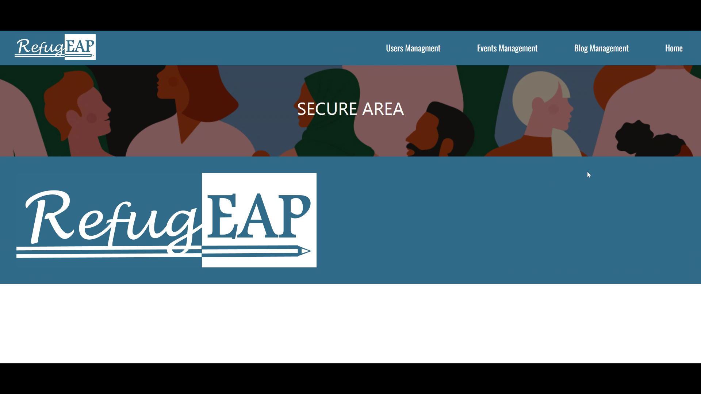
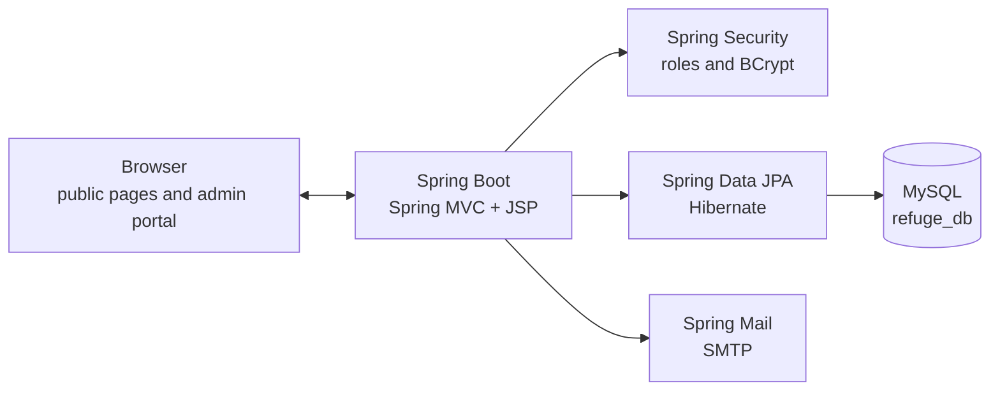

<div align="center">

# RefugEAP Website

**A content and administration platform for the RefugEAP Network.**


[Overview](#overview) · [Features](#features) · [Architecture](#architecture) · [Getting started](#getting-started) · [Admin portal](#admin-portal)

</div>


## Overview

RefugEAP is a free online pre-university academic English programme for refugee-background students across the UK. This repository contains the website built for the RefugEAP Network: a public information site with events, blog posts, resources and contact forms, plus a secure area for managing content and users.

The site is a Java web application built with Spring Boot, Spring MVC, JSP and MySQL. It was developed as a university group project and is shared as a portfolio example of a full-stack Spring application.

## Features

### Public site

- Home page introducing the RefugEAP programme and its purpose.
- About page for the network, its aims and working group.
- Programme, resources, evidence base, developing provision and directory pages.
- Events page with event details and audience submissions.
- Blog listing and individual blog pages.
- Contact form with message submission.
- English language programme page.
- Responsive, image-led layout shared across the public pages.

### Administration

- Secure login with Spring Security and BCrypt password hashing.
- Role-based access for `ROLE_ADMIN` and `ROLE_EDITOR`.
- User management: create users, delete users, reset passwords and change your own password.
- Blog management: review submissions, accept, discard, recover, delete and download attached files.
- Event management: review submitted events and accept, discard, recover or delete them.
- Contact management: review, accept, discard, recover or delete contact messages.
- Email notifications when a blog, event or contact message is submitted, and when a submission is approved or declined.
- Page view counter for public content.

## Screenshots

| Public site | Secure area |
|---|---|
|  |  |

## Architecture



The public controllers and the admin controllers share the same service and repository layer. JSP views live under `WEB-INF/views`, so they are rendered by Spring MVC rather than served as static files. Spring Security protects `/admin/**`, with user management restricted to administrators and content management available to editors and administrators.

## Tech stack

| Layer | Technology |
|---|---|
| Language | Java 11 |
| Framework | Spring Boot 2.7.8, Spring MVC |
| View layer | JSP, JSTL, HTML, CSS, JavaScript |
| Security | Spring Security, BCrypt |
| Persistence | Spring Data JPA, Hibernate, MySQL 8 |
| Email | Spring Boot Mail, SMTP |
| Build | Gradle wrapper |

## Getting started

### Prerequisites

- JDK 11
- MySQL 8
- A MySQL user with permission to create the `refuge_db` database
- Optional: an SMTP account for email notifications

### 1. Create the database

The schema and seed data are in [`refuge_db.sql`](Project/RefugEAP-Project/refuge_db.sql). It creates the `refuge_db` database, tables, roles and demo users.

Run the whole file in MySQL Workbench or the MySQL command line:

```bash
mysql -u root -p < Project/RefugEAP-Project/refuge_db.sql
```

### 2. Configure the application

Edit [`application.properties`](Project/RefugEAP-Project/src/main/resources/application.properties):

```properties
spring.datasource.url=jdbc:mysql://localhost:3306/refuge_db
spring.datasource.username=your_mysql_user
spring.datasource.password=your_mysql_password

spring.mail.username=your_email@example.com
spring.mail.password=your_app_password
```

For Gmail, use an App Password rather than your normal account password. Update the sender address used by `EmailService` and `PageController` if you want notifications to come from your own account.

### 3. Run the application

From `Project/RefugEAP-Project`:

```bash
./gradlew bootRun
```

On Windows:

```powershell
.\gradlew.bat bootRun
```

Open <http://localhost:8080>.

## Admin portal

The login page is at <http://localhost:8080/login>. The SQL seed file creates demo `ROLE_ADMIN` and `ROLE_EDITOR` users for local development. Their credentials are intentionally not repeated in this README. Change the seeded passwords before exposing the application, and create your own users through the admin portal.

| Role | Access |
|---|---|
| `ROLE_ADMIN` | User management, content management and the admin portal |
| `ROLE_EDITOR` | Blog, event and contact management |

## Project layout

```text
RefugEAP-website/
├─ Project/RefugEAP-Project/
│  ├─ src/main/java/com/example/refugeapproject/
│  │  ├─ controller/          Page, admin and email controllers
│  │  └─ membership/          User, role, blog, event and contact entities
│  ├─ src/main/resources/
│  │  ├─ application.properties
│  │  └─ keys.jks
│  ├─ src/main/webapp/
│  │  ├─ WEB-INF/views/       JSP pages
│  │  └─ images/              Site images and team photographs
│  ├─ build.gradle
│  └─ refuge_db.sql           Schema and seed data
├─ User-Manual.docx            End-user and setup manual
├─ checkpoint-screenshots/     Sprint evidence
├─ Design Ideas/               Early design work
└─ Presentation/               Project presentation
```

## Security notes

This is a coursework project, not a production-ready deployment. Before using it publicly:

- Replace the demo users and passwords created by the SQL seed file.
- Move database and mail credentials out of `application.properties` and into environment variables or a secrets manager.
- CSRF protection is currently disabled in `ConfigSecurity`; turn it back on and re-test the admin forms before exposing the app.
- Review the security rules for the admin routes.
- Remove local IDE files and any development keystores from the published repository.
- Review file upload validation before accepting contributions from the public.

## Credits

Built as a University of Leicester group project for the RefugEAP Network. RefugEAP, its logo and its public content belong to the RefugEAP Network. Third-party libraries retain their own licences.
